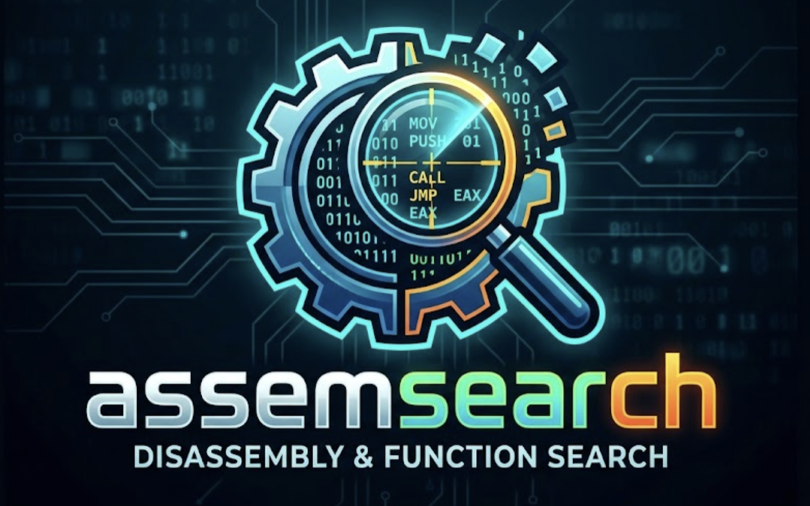
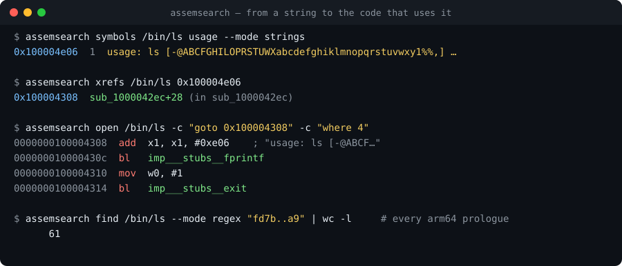
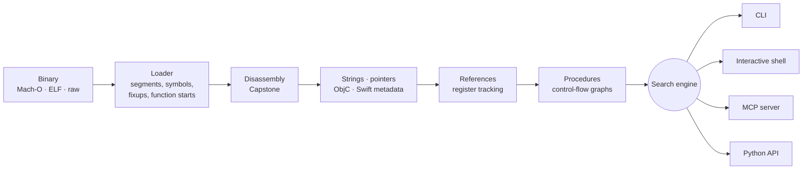

<div align="center">



### Search the assembly of any binary from your terminal, your scripts, or your AI agent.

**Find the code behind any string, call or byte pattern in a compiled app in seconds.**<br>
A disassembler-grade search engine for reverse engineering Mach-O and ELF binaries on arm64 and x86-64,<br>
with a built-in **MCP server** so Claude Code, Claude Desktop and other agents can reverse engineer alongside you.

[](LICENSE)
[](https://github.com/thinh-ngyuen15/assemsearch/stargazers)
[](docs/installation.md)
[](docs/mcp.md)
[](docs/analysis.md)
[](docs/analysis.md)
[](https://github.com/thinh-ngyuen15/assemsearch/actions/workflows/tests.yml)
[](docs/installation.md#option-3-standalone-executable)

**[Quick start](#-quick-start) · [Ask your agent](#-ask-your-agent) · [What you can search](#-what-you-can-search) · [How it works](#-how-it-works) · [Accuracy](#-accuracy) · [FAQ](#-faq) · [Docs](docs/README.md)**



</div>

---

## ✨ Why assemsearch?

You see a message, a feature or a behaviour in an app and want to know **where it lives in
the binary and how it works**. A full disassembler GUI is heavy for that. `strings` and `grep`
are too blind. assemsearch sits in between:

- **🧠 Real analysis, not just grep.** It builds procedures from control flow (branches, switch
  jump tables, tail calls, `noreturn` calls), tracks registers to resolve `adrp`/`add` and
  RIP-relative references, and decodes Objective-C, Swift and chained-fixup metadata. So
  *"who uses this string?"* gets a real answer.
- **🔍 Every kind of search.** Search assembly text, ASCII, hex bytes, **hex regular
  expressions with wildcards**, numbers in any width and byte order, your own comments,
  fuzzy symbol names, cross-references, callers and callees.
- **🤖 Built for AI agents.** `assemsearch mcp` exposes 33 tools over the Model Context Protocol,
  for listing, searching, reading and annotating code. Point Claude at a binary and ask questions.
- **⚡ Scriptable everywhere.** One-shot CLI commands for shell pipelines, an interactive shell
  with history and navigation, and a Python API.
- **📦 Zero friction.** `./install.sh` and you're done. Or copy one standalone executable
  with no Python required.
- **📏 Measured, not guessed.** On a 42 MB real-world app, every function the binary records
  becomes a procedure, and 99%+ of strings and string references are found ([details](#-accuracy)).

## 🚀 Quick start

```sh
git clone https://github.com/thinh-ngyuen15/assemsearch.git && cd assemsearch
./install.sh                    # uses uv, pipx or pip, whichever you have
assemsearch open /bin/ls        # interactive shell: type `help`
```

Or in one line, without cloning: `uv tool install git+https://github.com/thinh-ngyuen15/assemsearch.git`
(`pipx install git+…` works too).

No Python? Download the standalone executable from
[Releases](https://github.com/thinh-ngyuen15/assemsearch/releases) and put it on your `PATH`
([details](docs/installation.md)).

Five commands to try:

```sh
assemsearch symbols /bin/ls usage --mode strings          # fuzzy-find a string
assemsearch xrefs   /bin/ls 0x100004e06                   # who uses it?
assemsearch find    /bin/ls "bl imp___stubs__getenv"      # every call to getenv
assemsearch find    /bin/ls --mode regex "fd7b..a9"       # byte pattern with wildcards
assemsearch export  /bin/ls ls.asm.txt                    # full listing for grep / diff
```

Inspect a macOS app by pointing at the executable inside the bundle:
`assemsearch open /Applications/Calculator.app/Contents/MacOS/Calculator`.

## 🤖 Ask your agent

Give Claude Code (or any MCP client) a binary:

```sh
claude mcp add assemsearch -- assemsearch mcp /Applications/SomeApp.app/Contents/MacOS/SomeApp
```

Then just ask:

> *"Find where SomeApp shows the 'Trial expired' message and explain the check that leads to it."*
>
> *"List the Objective-C methods of the PreferencesController class and which of them touch NSUserDefaults."*
>
> *"Which procedures call `SecItemCopyMatching`? Summarise what each one looks up."*
>
> *"Rename the functions you've understood and add comments, so I can read the code later."*

The agent chains `search_strings` → `xrefs` → `procedure_assembly` → `procedure_callers`
→ `set_address_name` / `set_comment` on its own. All 33 tools are listed in the
[MCP guide](docs/mcp.md), along with the Claude Desktop JSON config.

## 🔍 What you can search

| Search | Example | Finds |
|---|---|---|
| **Assembly text** | `find BIN "bl imp___stubs__strcmp"` | Instructions, operands, labels, auto-comments |
| **ASCII string** | `find BIN --mode ascii "license"` | Text anywhere in the binary |
| **Hex bytes** | `find BIN --mode hex "c0 03 5f d6"` | Exact byte sequences |
| **Hex regex** | `find BIN --mode regex "e8 ........"` | Byte patterns with wildcards, sets and alternation |
| **Number** | `find BIN --mode number 0xdeadbeef --bits 32` | Constants stored in 8/16/32/64 bits, either byte order |
| **Your comments** | `find BIN --mode comment "TODO"` | Notes you saved earlier |
| **Symbols** | `symbols BIN parse --mode proc` | Fuzzy, ranked names, procedures, strings; filter by tag |
| **Cross-references** | `xrefs BIN _main` | Every reference to an address |
| **Call graph** | shell: `callers`, `callees` | Who calls what |
| **Objective-C messages** | shell: `objcrefs` | Every place a selector is sent |
| **Anything** | shell: `palette @init` | Commands, symbols, strings, documents |

The [searching guide](docs/searching.md) covers each mode and the hex-regex syntax.

### Supported targets

| | |
|---|---|
| **Formats** | Mach-O (thin and universal/fat), ELF (executables, shared objects, `.o`), raw firmware blobs at any base address |
| **CPUs** | arm64 and x86-64 (full analysis); 32-bit ARM and x86 (disassembly, calls, branches) |
| **Metadata** | Objective-C classes, categories, protocols, methods, ivars, properties; Swift type and field descriptors; dyld chained fixups; compact unwind; function starts |
| **Platforms** | macOS and Linux |

## 🧩 How it works



Procedures are built from control flow. The analysis starts from every known function start
and follows branches, bounded switch tables and tail calls, stopping at calls that never
return. The result is a set of basic blocks per procedure.
[How the analysis works](docs/analysis.md) goes deeper.

## 📏 Accuracy

We checked assemsearch against an established commercial disassembler on a 42 MB Swift and
Objective-C macOS app, comparing everything both tools found.

| Found by the reference tool, also found by assemsearch | arm64 | x86-64 |
|---|---|---|
| Functions the binary records | **100%** | **100%** |
| Procedures | **99.8%** | **97.9%** |
| Procedures with identical basic blocks | 96.7% | 99.0% |
| Names | 99.3% | 98.6% |
| Strings | 99.6% | 99.6% |
| References to strings | 99.8% | 99.8% |

Most of the remaining differences are code fragments the other tool turns into functions
even though the binary does not list them, and nothing calls them.

## 🐍 Python API

```python
from assemsearch.api import Document

doc = Document.open("/bin/ls")
for text, address in doc.getSegmentByName("__TEXT").getStringsList():
    if "usage" in text:
        for ref in doc.getReferencesOfAddress(address):
            proc = doc.getProcedureAtAddress(ref)
            print(hex(ref), doc.getNameAtAddress(proc.getEntryPoint()))
```

Classes for documents, segments, sections and procedures, with camelCase methods. See the
[API reference](docs/python-api.md).

## ❓ FAQ

<details>
<summary><b>Is this a replacement for IDA Pro, Ghidra or Binary Ninja?</b></summary>

No. assemsearch has no decompiler, no graph view and no debugger. It is the fast,
scriptable *search and navigation* layer: the part you reach for to answer "where is X and
who uses it?" from a terminal, a CI job or an AI agent. Use it next to your main
disassembler, or on its own when a GUI is overkill.
</details>

<details>
<summary><b>What does it depend on?</b></summary>

Python 3.10+ and the open-source [Capstone](https://www.capstone-engine.org/) disassembly
engine. Everything else (loaders, analysis, search) is assemsearch's own code. No other
reverse-engineering tool or licence is needed.
</details>

<details>
<summary><b>How fast is it?</b></summary>

Small tools like `/bin/ls` load in about a tenth of a second. A 42 MB app slice takes about
25 seconds and 1.5 GB of RAM to analyse. After that, searches are interactive.
</details>

<details>
<summary><b>Which binaries can it open?</b></summary>

Mach-O (including universal binaries: choose a slice with `--arch`), ELF executables, shared
libraries and object files, and raw dumps (`--raw --base 0x8000000`). Full analysis on arm64
and x86-64; basic support for 32-bit ARM and x86.
</details>

<details>
<summary><b>Can I keep my notes?</b></summary>

Yes. Names, comments, tags and bookmarks are saved with `save` to a `.asdb` file next to the
binary and restored the next time you open it. Comment search covers them too.
</details>

<details>
<summary><b>Does it modify the binary?</b></summary>

Never. assemsearch only reads files.
</details>

## 📚 Documentation

| | |
|---|---|
| [Installation](docs/installation.md) | Install script, wheel, standalone executable |
| [Command line](docs/cli.md) | `open`, `find`, `symbols`, `goto`, `xrefs`, `export`, `hexre`, `mcp` |
| [Interactive shell](docs/shell.md) | Every shell command, with an example session |
| [Searching](docs/searching.md) | Find modes, hex regex syntax, fuzzy matching, Go To |
| [MCP server](docs/mcp.md) | Connecting agents; all 33 tools |
| [Python API](docs/python-api.md) | Scripting reference |
| [How the analysis works](docs/analysis.md) | Pipeline, accuracy, limits |
| [Feature map](docs/feature-map.md) | Each feature → module → command |
| [Development](docs/development.md) | Code layout, tests, releasing |

## 🤝 Contributing

Issues and pull requests are welcome, especially:

- binaries where assemsearch misses a procedure, string or reference that another tool finds;
- new loaders (PE/COFF), CPU support, and Swift metadata coverage;
- examples of what you or your agent found with it.

```sh
uv sync && uv run pytest        # 151 tests, about 2 seconds
```

## ⚖️ Responsible use

assemsearch is for learning, interoperability, security research and analysing software you
are allowed to analyse. Respect software licences and the law where you live. Only
reverse engineer what you own or have permission to examine.

assemsearch is an independent project. It is not affiliated with or endorsed by Hex-Rays (IDA Pro),
the NSA (Ghidra) or Vector 35 (Binary Ninja).
Product names are used only to describe compatibility and comparisons.

<div align="center">

**If assemsearch saved you an afternoon of scrolling through disassembly, a ⭐ helps others find it.**

</div>

## 📄 License

[MIT](LICENSE) © 2026 Thinh Nguyen
